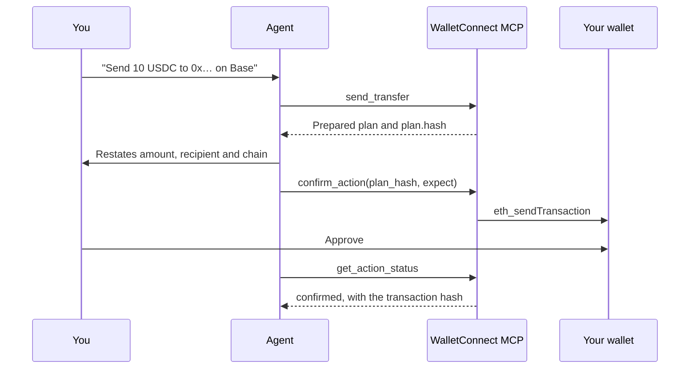

import McpWaitlist from "@/content/snippets/mcp-waitlist.mdx";

<McpWaitlist components={props.components} />

The WalletConnect MCP is a hosted [Model Context Protocol](https://modelcontextprotocol.io) server. It lets any MCP client, such as Claude, Claude Code, Cursor or ChatGPT, read your balances and prepare transfers and swaps on your own wallet over WalletConnect. The same tools are served as an [HTTP API](#http-api) for agents and backends that don't speak MCP.

The server is the app side of a WalletConnect session. It never holds signing keys: it can only ask your wallet to sign, and you approve every transaction in your wallet app.

<Callout type="warning">
The MCP runs on **mainnet with real funds**. Every transfer and swap moves real money. Start with small amounts.
</Callout>

## What you can do

- **Check your portfolio.** "What's in my wallet on Base? Give me the USD total." Every token the wallet holds, with USD prices and values. Reads never reach your wallet, so there is nothing to approve.
- **Send money.** "Send 10 USDC to `0x…` on Arbitrum." The server builds the transfer, the agent restates it, and you approve it in your wallet.
- **Swap tokens.** "How much ETH would I get for 25 USDC?" then "Do it." A live Uniswap V3 quote, then an exact-amount approval and the swap, prepared as one action.
- **Build agents that pay.** Backends and agent frameworks call the [HTTP API](#http-api) with the same tools, so an agent can propose a payment and the user signs it on their phone.

## Connect a client

The MCP endpoint is:

```text
https://mcp.walletconnect.com/mcp
```

<Tabs items={["Claude Code", "Claude and Claude Desktop", "Other MCP clients"]}>
<Tab value="Claude Code">

```bash
claude mcp add --transport http walletconnect https://mcp.walletconnect.com/mcp
```

Then start `claude`, run `/mcp`, select **walletconnect** and sign in.

</Tab>
<Tab value="Claude and Claude Desktop">

Add `https://mcp.walletconnect.com/mcp` as a custom connector in **Settings → Connectors**, then select **Connect**.

</Tab>
<Tab value="Other MCP clients">

Add `https://mcp.walletconnect.com/mcp` as a remote MCP server. Any client that supports remote servers with OAuth 2.1 can connect.

</Tab>
</Tabs>

The first time you connect, a consent page opens in your browser:

<Steps>
  <Step>
    ### Allow access
    Review which app is asking and where Allow sends you, then select **Allow**.
  </Step>
  <Step>
    ### Choose your wallet
    Pick your wallet from the list, or scan the QR code with any WalletConnect-compatible wallet.
  </Step>
  <Step>
    ### Approve the session
    Approve the connection in your wallet app. The page shows **Connected** and your agent can now use your wallet.
  </Step>
</Steps>

You can also connect from the chat: ask "Connect my wallet" and the agent calls `wallet_connect`, which returns a connect link and a QR code.

<Callout type="info">
The pairing link works like a password: anyone who scans it pairs their wallet to your account. Only share it with yourself. It expires after 5 minutes.
</Callout>

## How a transaction works

Every write tool prepares an action and sends nothing. The agent has to show you the plan and confirm it before your wallet sees anything.



1. **Prepare.** A write tool returns an `action_id`, `status: "prepared"`, every step decoded into whole units (asset, amount, recipient, chain, contract and, for a swap, the quote and minimum out), the raw `to`, `data` and `value` each step will send, and `plan.hash`, a SHA-256 over those bytes.
2. **Confirm.** The agent compares the plan with your request, tells you what will happen, and calls `confirm_action` with the hash and `expect`, its own restatement of your request (`plan.expectKeys` lists the fields). The server sends the first step only if the hash matches the stored plan, every `expect` field matches the plan, and the plan is less than 5 minutes old. It sends the exact bytes it hashed.
3. **Approve.** You approve the request in your wallet. Each wallet request expires 5 minutes after it is sent.
4. **Track.** The agent polls `get_action_status` until the action reaches a final status: `confirmed`, `rejected`, `expired`, `failed` or `cancelled`. Multi-step actions, such as approve then swap, advance on their own as each step confirms.

A plan that doesn't match is refused and written to the audit log, and the agent cancels it with a reason.

While a step waits for your signature, the action carries `approveLinks`: links that open your wallet app on that exact request. On a phone, the agent shows you the link; on a desktop client, it can open your wallet directly.

## Security

Two layers protect you. The server's policy blocks anything outside its limits before it reaches your wallet, and anything that passes still needs your signature.

### Limits

| Guardrail | Value |
| --- | --- |
| Max per transaction | 0.05 ETH · 50 USDC · 0.0005 WBTC · 0.5 SPCXON |
| Tokens | Only the listed assets below. A token without a cap can't be moved. |
| Approvals | Exact amount only, and only to contracts in the protocol's manifest (the Uniswap router). Never unlimited. |
| Swap slippage | 0.5% by default, 1% at most |
| Swap pre-check | Every swap runs against the chain as you before it is prepared, so a token that refuses to move (a blocklisted holder, a restricted tokenized asset) is refused before it reaches your wallet. |
| Expiry | Plans expire 5 minutes after they are prepared; wallet requests 5 minutes after they are sent. |

### Transaction checks

The server runs these checks in code on every transaction. Each one refuses the action before it reaches your wallet, except the receipt check, which runs after the wallet answers.

**When an action is prepared**

| Check | What the server does |
| --- | --- |
| Input validation | Addresses must be valid `0x` addresses and are checksummed. Amounts must be positive decimal strings in whole units, parsed with the token's own decimals. Every argument is checked against the tool's schema. |
| Chain and session | The chain must be one of the enabled chains, and a wallet must be connected on that chain. |
| Listed tokens only | A transfer, approval or swap must use a token listed for that chain. An unlisted token address is refused. |
| Per-transaction caps | Native value and token amounts are checked against the caps, in base units. A token with no configured cap can't be moved at all. |
| Approval spender | An approval can only name a contract from the protocol's manifest for that chain as the spender, and only for the exact amount of the trade. |
| Contract call target | A contract call must go to the exact address the manifest lists under that contract's name, such as the Uniswap router. |
| Balance | Swaps check your on-chain balance of the asset being sold first. |
| Slippage and deadline | Swaps set a minimum output of the quote minus slippage (default 0.5%, at most 1%) and a 10-minute deadline. The output always goes to your own address. |
| Dry run | Swaps are simulated against the chain as your address before the plan is prepared. The token being sold is also asked whether it will move, so a blocklisted holder or a restricted tokenized asset is refused here rather than in your wallet. |
| One action at a time | A new action is refused while another is waiting for your wallet. An unconfirmed plan is replaced by the next one. |

**When an action is confirmed**

| Check | What the server does |
| --- | --- |
| Plan hash | `plan_hash` must equal the SHA-256 the server computed over every step's chain, `to`, `data`, `value` and skip condition. |
| Restatement | Every fact in `plan.expectKeys` must match the agent's `expect`. Numbers are compared without leading or trailing zeros, and everything else is case-insensitive. A missing or different field is refused and logged. |
| Plan expiry | A plan not confirmed within 5 minutes expires, and nothing is sent. |
| Exact bytes | The wallet receives the bytes that were hashed, not a re-encoding. |

**While an action runs**

| Check | What the server does |
| --- | --- |
| Allowance skip | An approval step is skipped only if the on-chain allowance already covers the exact amount. |
| Settle delay | The next step waits 8 seconds after the previous one confirms, so your wallet reads an up-to-date nonce. |
| Wallet answer | The wallet's reply must be a valid transaction hash, or the step fails. A nonce error is re-sent once, after 10 seconds. |
| Receipt | Each transaction is followed to its receipt. A revert marks the step `failed` and stops the action. |
| Request expiry | A wallet request with no answer after 5 minutes is marked `expired`. |

Each user has an audit log on the server. It records every action prepared, confirmed, refused for a mismatch, cancelled, replaced or expired, and every step sent, submitted, confirmed, reverted or retried.

## Supported chains and assets

| Chain | CAIP-2 | Swaps (Uniswap V3) |
| --- | --- | --- |
| Base (default) | `eip155:8453` | ETH, USDC |
| Ethereum | `eip155:1` | ETH, USDC, WBTC, SPCXON |
| Optimism | `eip155:10` | ETH, USDC, WBTC |
| Arbitrum | `eip155:42161` | ETH, USDC, WBTC |

Tools called without a `chain` use Base. SPCXON is Ondo's tokenized SpaceX, available on Ethereum only. Swaps quote all four Uniswap fee tiers and use the best one for each trade.

Any WalletConnect-compatible wallet works. Balances, prices and quotes come from the WalletConnect Blockchain API; your wallet is only ever asked to sign.

## Tools

| Tool | What it does | Needs approval |
| --- | --- | --- |
| `wallet_connect` | Connected accounts, or a connect link with a QR code when no wallet is connected | No |
| `wallet_status` | Accounts, wallet name, session expiry and open actions. Waits while a pairing is pending. | No |
| `wallet_disconnect` | Ends the session and cancels queued steps | No |
| `get_portfolio` | Every token the wallet holds on a chain, with USD prices and values | No |
| `send_transfer` | Prepares a native or ERC-20 transfer | Yes |
| `swap_assets` | Which assets can be swapped on which chains | No |
| `swap_quote` | Uniswap V3 quote between two listed assets | No |
| `swap_execute` | Prepares an exact-amount approval and the swap as one action, checked against the chain first | Yes |
| `confirm_action` | Sends a prepared action to the wallet once the plan hash and the agent's restatement match | Yes |
| `get_action_status` | Waits up to 55 seconds for a change and returns every step's state | No |
| `cancel_action` | Cancels a prepared action, or steps not yet sent, with a reason for the audit log | No |

## HTTP API

The same tools are available as JSON routes under `https://mcp.walletconnect.com/api/v1`, with the same prepare, confirm and track flow.

- The OpenAPI 3.1 document is at [`/api/v1/openapi.json`](https://mcp.walletconnect.com/api/v1/openapi.json) and needs no token. A readable reference is at [`/api/docs`](https://mcp.walletconnect.com/api/docs).
- `GET /api/v1` returns the version, the agent instructions, the enabled chains and caps.
- `GET /api/v1/tools` lists every tool with its JSON Schema, ready to register as functions in any agent framework.

### Authorize

Tokens come from the same OAuth 2.1 server, with PKCE. Name the API as the resource when you authorize: `resource=https://mcp.walletconnect.com/api`. A user has to open the consent page and approve in their wallet; there are no API keys.

1. A call without a token returns `401` and points to the resource metadata, which names the authorization server.
2. Register your client (see below), send the user to `/authorize` with a code challenge and the resource, and exchange the code at `/token`.
3. Access tokens last one hour and refresh tokens rotate. A grant that keeps refreshing never expires; one left idle for 30 days does.

How your client registers depends on what it is:

- **A local agent or CLI** registers itself at `/register` with a loopback redirect (`http://localhost:<port>/…`). Nothing to set up.
- **A hosted app** uses a [client ID metadata document](https://datatracker.ietf.org/doc/html/draft-ietf-oauth-client-id-metadata-document-00): its `client_id` is an HTTPS URL on its own domain serving `client_name`, `redirect_uris` and `token_endpoint_auth_method`. The consent page shows that domain next to the app's name.
- **A platform that can do neither**, such as ChatGPT Actions, needs a pre-registered client. Contact us to get one.

A client that creates the WalletConnect pairing itself adds `connect=skip` to the authorization request. The consent page then shows only Allow and Deny, and the client pairs through `POST /api/v1/wallet/pairings`.

### Send a transfer

```bash
# 1. Prepare
curl -X POST https://mcp.walletconnect.com/api/v1/actions/transfers \
  -H "Authorization: Bearer $ACCESS_TOKEN" \
  -H "Content-Type: application/json" \
  -d '{"to": "0xRECIPIENT_ADDRESS", "amount": "1", "token": "USDC", "chain": "base"}'

# 2. Confirm with plan.hash and your restatement of the request (keys from plan.expectKeys)
curl -X POST https://mcp.walletconnect.com/api/v1/actions/ACTION_ID/confirm \
  -H "Authorization: Bearer $ACCESS_TOKEN" \
  -H "Content-Type: application/json" \
  -d '{"plan_hash": "PLAN_HASH", "expect": {"kind": "transfer", "chain": "Base", "asset": "USDC", "amount": "1", "to": "0xRECIPIENT_ADDRESS"}}'

# 3. Wait for the wallet's answer
curl "https://mcp.walletconnect.com/api/v1/actions/ACTION_ID?wait_seconds=55" \
  -H "Authorization: Bearer $ACCESS_TOKEN"
```

### Routes

| Route | Tool |
| --- | --- |
| `GET /api/v1/wallet?wait_seconds=` | `wallet_status` |
| `POST /api/v1/wallet/pairings` | `wallet_connect` |
| `GET /api/v1/wallet/pairings/{id}` | Pairing status, with the session once approved |
| `DELETE /api/v1/wallet/session` | `wallet_disconnect` |
| `GET /api/v1/portfolio?chain=` | `get_portfolio` |
| `GET /api/v1/swaps/assets?chain=` | `swap_assets` |
| `GET /api/v1/swaps/quote?from=&to=&amount=&chain=` | `swap_quote` |
| `POST /api/v1/actions/transfers` | `send_transfer` |
| `POST /api/v1/actions/swaps` | `swap_execute` |
| `GET /api/v1/actions` | Open actions |
| `GET /api/v1/actions/{id}?wait_seconds=` | `get_action_status` |
| `POST /api/v1/actions/{id}/confirm` | `confirm_action` |
| `POST /api/v1/actions/{id}/cancel` | `cancel_action` |
| `POST /api/v1/tools/{name}` | Any tool; the body is its arguments |

Prepare routes answer `201` with the prepared action. Every success is `{ text, data, images? }`: the one-line text an MCP client would see, the tool's typed data, and images such as the pairing QR code.

### Errors

Errors are `{ error: { code, message, issues? } }`.

| Status | Code | When |
| --- | --- | --- |
| `400` | `invalid_request` | The arguments don't match the schema; `issues` names each field |
| `401` | | Missing or expired token |
| `404` | `not_found` | Unknown tool, action or pairing |
| `409` | `conflict` | The wallet or action is in the wrong state: not connected, another open action, an expired or mismatched plan |
| `422` | `blocked` | A policy guardrail: caps, unlisted tokens or chains, bad amounts or addresses |
| `500` | `internal` | Server error |

## Not supported yet

Lending, sign-in with Ethereum (SIWE), per-user enablement of protocols, limits in USD, bridging, a local stdio server, and Solana.

## FAQ

<Accordions multiple>
  <Accordion title="Does the server hold my keys?">
    No. It is the app side of a WalletConnect session. It can only request `eth_sendTransaction`, and your wallet signs.
  </Accordion>
  <Accordion title="Can a malicious prompt drain my wallet?">
    A prompt would have to get past the per-transaction caps, the token list and the contract allowlist, then match the plan hash and the restatement, and then still needs your signature in your wallet.
  </Accordion>
  <Accordion title="Why don't reads ask me to approve anything?">
    Balances, prices and quotes come from the WalletConnect Blockchain API. Your wallet is only asked to sign transactions.
  </Accordion>
  <Accordion title="My wallet showed an error but the agent keeps waiting.">
    Wallets don't send broadcast errors back over WalletConnect, so the server can't tell a failed broadcast from a request you haven't looked at yet. Reject the request in your wallet, and the action turns `rejected`. Then try again.
  </Accordion>
  <Accordion title="A swap skipped the approval step.">
    That's expected. If the allowance is already on chain, the approval step is `skipped` and only the swap is sent.
  </Accordion>
  <Accordion title="How do I switch wallets?">
    Ask the agent to disconnect your wallet, or call `wallet_connect` with `new_session: true` to pair a different one.
  </Accordion>
</Accordions>
