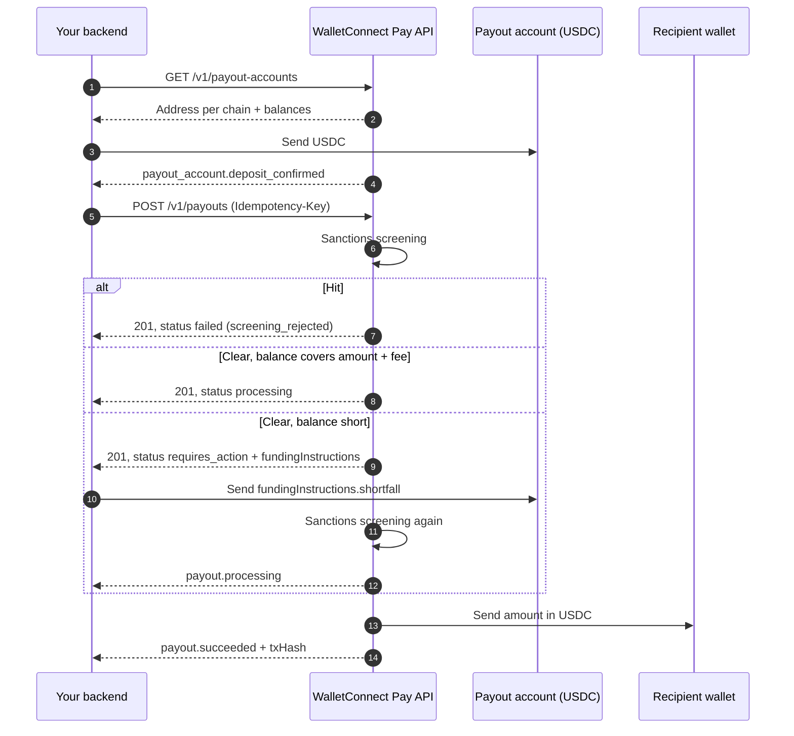

Payouts send funds from your payout account to your recipients' wallets. You fund the account, create a payout with one API call, and follow it to `succeeded` through [webhooks](/payments/payouts/webhooks) and `GET /v1/payouts/{payoutId}`. Every destination is screened against sanctions lists before funds move.

<Callout type="info">
Payouts support USDC on the EVM chains that `GET /v1/payout-accounts` lists for your account.
</Callout>

## How it works

## Before you start

- **Payout API key.** Payouts use their own key, prefixed `wcpo_`. Your payments API key is refused. We issue your payout key when we set up payouts for you, and we can't show it again, so store it in your secrets manager. To rotate or revoke a key, contact us. Rotating revokes the old key at once, so plan the switch. Send the key in the `Api-Key` header, from your backend only.
- **Live only.** Payouts have no [test mode](/payments/test-mode).
- **Base URL:** `https://api.merchant.pay.walletconnect.com`
- **Amounts** are integer strings in the asset's smallest unit. USDC has 6 decimals on most chains, so `"1000000"` is 1 USDC, but it has 18 on BNB Smart Chain. Check the decimals of the asset you pay out: each balance in `GET /v1/payout-accounts` gives its `decimals`.
- **Chains, assets and accounts** use CAIP identifiers: CAIP-2 chains (`eip155:8453`), CAIP-19 assets (`eip155:8453/erc20:0x8335…2913`) and CAIP-10 accounts (`eip155:8453:0xabc…`).
- **Field names** are camelCase in request and response bodies.

## Keep your payout API key safe

<Callout type="warning" title="Anyone with your payout API key can send your funds">
Anyone who has your payout API key can send the funds in your payout account to any wallet, and payouts can't be reversed. Treat the key like the keys to the money in your payout account.
</Callout>

- Keep it only in your backend secrets manager. Never put it in frontend or mobile code, logs, tickets, chat or email.
- Give access only to the people and services that need it.
- We send the key once, through a secure link that expires. Save it to your secrets manager and don't forward the link.
- Keep in the payout account only what you need for upcoming payouts.
- If you think the key has leaked, contact us right away and we'll revoke it. Revoking takes effect at once, so you'll need a new key to keep paying out.

## Next steps

<Cards>
  <Card title="Fund your payout account" href="/payments/payouts/fund-your-account">
    Find your payout address and keep a USDC balance.
  </Card>
  <Card title="Create a payout" href="/payments/payouts/create-a-payout">
    Send funds to a recipient with one API call.
  </Card>
  <Card title="Webhooks" href="/payments/payouts/webhooks">
    Follow every payout to a final status.
  </Card>
  <Card title="Errors" href="/payments/payouts/errors">
    Error codes and what to do about each one.
  </Card>
</Cards>
