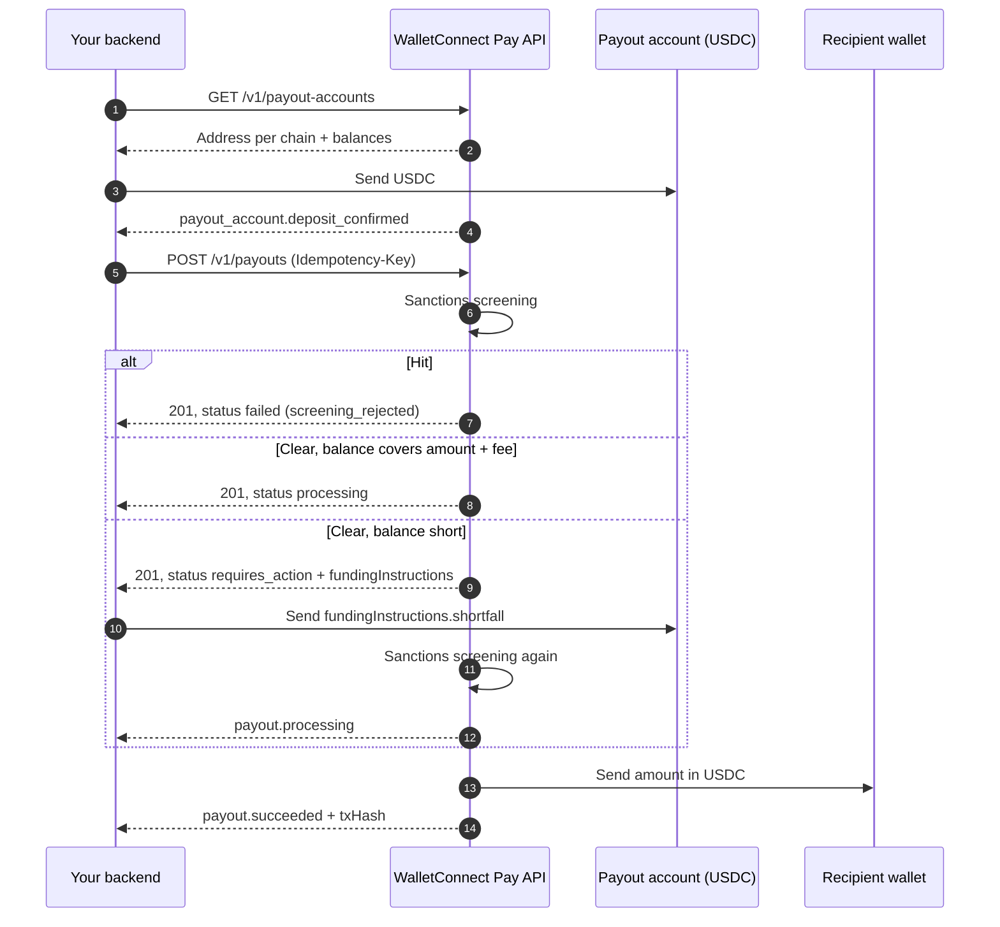

You fund your payout account, create a payout, and follow it to `succeeded` through [webhooks](/payments/webhook-events/payouts) or the API. Every destination is screened against sanctions lists before funds move.

<Callout type="info">
Supported: USDC on the EVM chains that `GET /v1/payout-accounts` lists for your account.
</Callout>

## How it works

You fund your payout account, create a payout, and we send the USDC to your recipient. The diagram shows each call and webhook along the way, including what happens when your balance is short:

## Before you start

- **Payout API key.** Prefixed `wcpo_`. Your payments API key is refused. We issue your payout key when we set up payouts for you, and we can't show it again, so store it in your secrets manager. To rotate or revoke a key, contact us. Rotating revokes the old key at once, so plan the switch. Send the key in the `Api-Key` header, from your backend only.
- **Live only.** Payouts have no [test mode](/payments/test-mode).
- **Base URL:** `https://api.merchant.pay.walletconnect.com`
- **Amounts** are integer strings in the asset's smallest unit. USDC has 6 decimals on most chains, so `"1000000"` is 1 USDC, but it has 18 on BNB Smart Chain. Check the decimals of the asset you pay out: each balance in `GET /v1/payout-accounts` gives its `decimals`.
- **Chains, assets and accounts** use CAIP identifiers: CAIP-2 chains (`eip155:8453`), CAIP-19 assets (`eip155:8453/erc20:0x8335…2913`) and CAIP-10 accounts (`eip155:8453:0xabc…`).
- **Field names** are camelCase in request and response bodies.

## Keep your API key safe

<Callout type="warning" title="Anyone with this key can send your funds">
Whoever holds the key can send your account's balance to any wallet, and transfers can't be reversed. Treat it like the keys to that money.
</Callout>

- Keep it only in your backend secrets manager. Never put it in frontend or mobile code, logs, tickets, chat or email.
- Give access only to the people and services that need it.
- We send the key once, through a secure link that expires. Save it to your secrets manager and don't forward the link.
- Keep in the account only what you need for upcoming transfers.
- If you think the key has leaked, contact us right away and we'll revoke it. Revoking takes effect at once, so you'll need a new key to keep sending funds.

## Next steps

<Cards>
  <Card title="Integration guide" href="/payments/payouts/integration">
    Fund your account, send funds and keep your records in step, in three steps.
  </Card>
  <Card title="Webhook events" href="/payments/webhook-events/payouts">
    Get notified as each transfer reaches a final status.
  </Card>
  <Card title="Reference" href="/payments/payouts/reference">
    Statuses, failure reasons and error codes.
  </Card>
</Cards>
