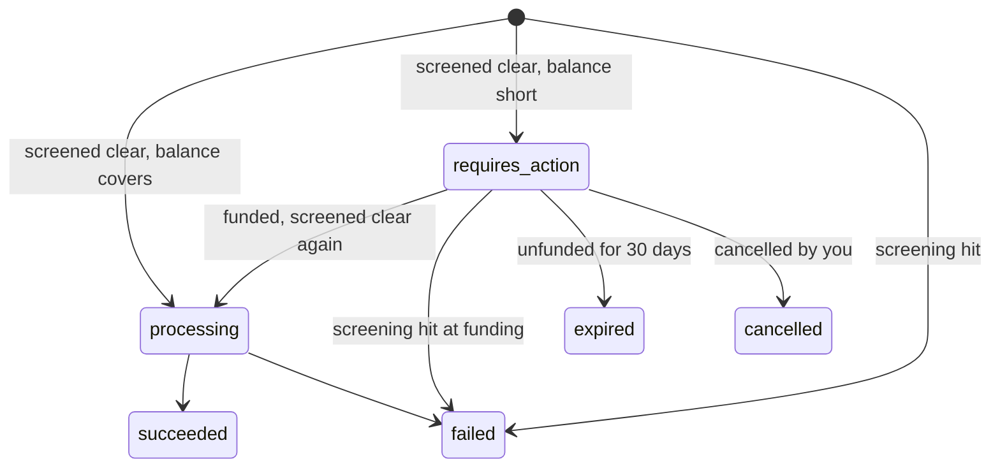

## Statuses

| Status | Final | Meaning |
| --- | --- | --- |
| `requires_action` | No | Waiting for funds. `fundingInstructions` says what to send. See [Handle requires_action](/payments/payouts/create-a-payout#handle-requires_action). |
| `processing` | No | Funds are held and the transfer is under way. |
| `succeeded` | Yes | The recipient received `amount`. |
| `failed` | Yes | Nothing reached the recipient. `failureReason` says why. Any held `amount + feeAmount` returns to your balance. |
| `expired` | Yes | Not funded within 30 days of creation. |
| `cancelled` | Yes | You cancelled it while it waited for funds. Nothing was held or sent. |

`txHash` is set on `succeeded`. In rare cases the transfer is relayed without a hash we can report, and `txHash` stays `null`; the payout still succeeded.

## Substatuses

`substatus` says where a payout is within its status. It is computed on read and can change without a webhook.

| Status | Substatus | Meaning |
| --- | --- | --- |
| `requires_action` | `awaiting_funding` | Waiting for a deposit. |
| `processing` | `executing` | The transfer is being prepared. |
| `processing` | `submitted_onchain` | The transfer was sent to the chain and is confirming. |
| `processing` | `stalled` | The transfer is taking longer than expected (over 10 minutes) or is being retried. No action needed. |
| `succeeded` | `settled` | Delivered. |
| `failed` | Same as `failureReason` | See [Failure reasons](#failure-reasons). |
| `expired` | `expired` | Not funded in time. |
| `cancelled` | `cancelled` | Cancelled by you. |

## Failure reasons [#failure-reasons]

`failureReason` is set on `failed` and `expired` payouts and is `null` otherwise. Its values are fixed, so you can branch on them.

| Value | Status | Meaning |
| --- | --- | --- |
| `screening_rejected` | `failed` | The destination failed sanctions screening, at creation or at funding. Nothing was held or sent. |
| `transfer_rejected` | `failed` | The transfer was refused before it was sent. Nothing moved. |
| `transfer_failed` | `failed` | The transfer failed on chain, or kept failing after five attempts. Nothing reached the recipient. |
| `insufficient_balance_expired` | `expired` | The payout wasn't funded within 30 days. |

New values may be added. Treat an unknown value as a failure in your support flow.
