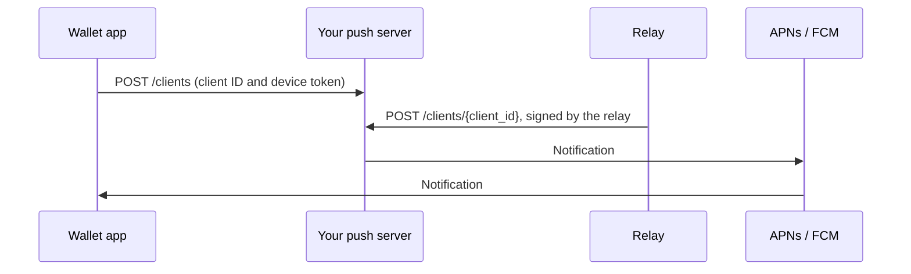

WalletConnect lets your wallet receive push notifications for incoming requests through a self-hosted push server.

When a dapp sends your wallet a session proposal, a session request or an authentication request, the relay sends it to the push URL set on your project. The push server behind that URL looks up the device and sends the notification through APNs or FCM.

The push URL points at a server you run. Use the [open-source push server](https://github.com/reown-com/push-server), or write your own against the push server API.



## Run the push server

Build the image from `slim.Dockerfile`. This is the single-tenant build: it serves one wallet app and reads its APNs and FCM credentials from environment variables. The credentials stay on your server; the dashboard stores only the push URL.

| Variable | Value |
| --- | --- |
| `PUBLIC_URL` | The server's public address, for example `https://push.example.com`. |
| `DATABASE_URL` | A Postgres database for device registrations. The server runs its own migrations on start. |
| `TENANT_DATABASE_URL` | Must be set, and left empty in this build. |
| `RELAY_PUBLIC_KEY` | The relay's signing key, from `https://relay.walletconnect.com/public-key`. |
| `FCM_V1_CREDENTIALS` | Your Firebase service account key, as JSON. |
| `APNS_TYPE`, `APNS_TOPIC` | `Token` or `Certificate`, and your app's bundle ID. |
| `APNS_PKCS8_PEM`, `APNS_KEY_ID`, `APNS_TEAM_ID` | For `Token`: your `.p8` key, base64-encoded, and its key and team IDs. |
| `APNS_CERTIFICATE`, `APNS_CERTIFICATE_PASSWORD` | For `Certificate`: your `.p12` certificate, base64-encoded, and its password. |

Keep `VALIDATE_SIGNATURES` at its default of `true`, so the server rejects requests that the relay did not sign.

## Set the push URL

In the [WalletConnect Dashboard](https://dashboard.walletconnect.com), open your project's **Push** page and choose **Create Push URL**. The page appears only for wallet projects.


Enter your `PUBLIC_URL`:

- It must use HTTPS and a public domain name, not an IP address.
- It can include a base path, but no query string, fragment or credentials, because the relay appends `/clients/{client_id}` to it.

The relay caches project settings, so a change can take several minutes to take effect.

## Register devices

The relay knows each wallet only by its relay client ID, and APNs and FCM deliver only to a device token. Registering a device stores the pair on your push server, so that when the relay asks it to notify a client ID, the server knows which device token to send to. A device that is not registered gets no notifications.

Don't use the SDK's push registration (`WalletKit.instance.register(deviceToken:)` on iOS, `WalletKit.registerDeviceToken` on Android, `walletKit.registerDeviceToken` in React Native) with a self-hosted server. On Android and React Native it always registers with WalletConnect's hosted server. On iOS you can change the host with `pushHost`, but the SDK sends to `/{projectId}/clients`, which the self-hosted server doesn't serve. Your app has to register with your server directly instead:

```http
POST https://push.example.com/clients
Content-Type: application/json

{ "client_id": "<relay client ID>", "type": "fcm", "token": "<device token>", "always_raw": true }
```

- `client_id` is the ID the wallet uses on the relay: `CoreClient.Push.clientId` on Android, `Networking.interactor.getClientId()` on iOS, `walletKit.core.crypto.getClientId()` in React Native.
- `type` is `apns`, `apns-sandbox` or `fcm`.
- `always_raw` sets what the notification contains. It matches the SDKs' `enableEncrypted` option:
  - `true`: the notification carries the encrypted request as `topic`, `tag` and `message`. Your app decrypts it and shows its own text, for example the dapp's name and what it asks for.
  - `false`: the user sees a fixed "Signature required" alert written by the relay, and your app does not decrypt anything.

Send the registration when the app starts and has a device token, and again whenever the OS issues a new token. To stop notifications, for example when the user turns them off or logs out, send `DELETE /clients/{client_id}`.

## Delivery

The open-source push server already handles this. If you write your own, respond to each request from the relay within 30 seconds:

- Return a 2xx response once the notification is handed to APNs or FCM.
- Return a 5xx response only when a retry could succeed. The relay retries after a timeout, a network error or a 5xx response, and does not retry any other response.
