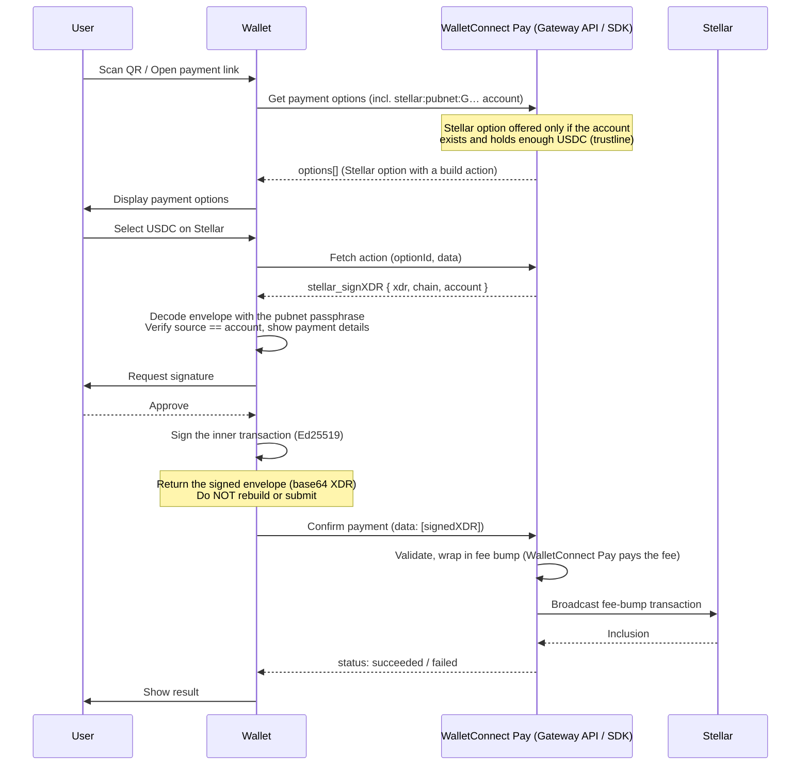

WalletConnect Pay supports Stellar payments with USDC. Stellar is a **sign-only, fee-sponsored** chain: WalletConnect Pay builds the payment transaction, your wallet signs it with [`stellar_signXDR`](/wallets/chains/stellar#stellar-signxdr), and WalletConnect Pay wraps the signed transaction in a [fee-bump transaction](https://developers.stellar.org/docs/learn/encyclopedia/transactions-specialized/fee-bump-transactions) and broadcasts it. The buyer never pays the XLM network fee, and your wallet never submits the transaction.

<Info>
This guide applies whether you integrate with the **Wallet Pay SDK** or directly with the **Gateway API** ([API-first](/payments/wallets/api-first)). The signing requirements are identical — Stellar actions arrive as `walletRpc` actions, and the signed envelope is returned in the results array. The code samples below use SDK method names; if you are integrating API-first, the equivalents are:

| SDK | Gateway API |
|-----|-------------|
| `getPaymentOptions({ accounts })` | `POST /v1/gateway/payment/{id}/options` with `accounts[]` |
| `option.actions` / `getRequiredPaymentActions` | the option's `actions[]`, resolved via `POST /v1/gateway/payment/{id}/fetch` when an action is type `build` |
| `confirmPayment(data)` | `POST /v1/gateway/payment/{id}/confirm` with `results[]` |

Everything else in this guide — advertising Stellar accounts, routing by namespace, the `stellar_signXDR` payload, and returning the signed envelope — is the same in both integrations.
</Info>

## Stellar payment flow

A Stellar payment follows the same three-call flow as any other WalletConnect Pay payment. The Stellar-specific parts are the signing method (`stellar_signXDR`), the checks your wallet performs before signing, and the fee bump WalletConnect Pay adds on confirm.



<Warning>
The `data[]` you submit on confirm must match the option's `actions[]` in **order and length**. A Stellar option has a single action, so `data` contains exactly one signed envelope.
</Warning>

## Key differences from other chains

1. **Fee-sponsored** — WalletConnect Pay wraps the buyer-signed transaction in a fee bump and pays the XLM fee. The buyer only needs USDC; there is no fee or gas balance check.
2. **Sign only, never submit** — use `stellar_signXDR`, not `stellar_signAndSubmitXDR`. Submitting the inner transaction yourself would make the buyer pay the fee and consume the sequence number WalletConnect Pay is waiting for, which fails the payment.
3. **The envelope is opaque** — WalletConnect Pay pins the transaction to the buyer's next sequence number, a single USDC payment operation, no memo, and a time bound that ends when the quote expires. Confirm validates all of these, so re-building, adding operations, changing the fee, or adjusting the time bounds gets the payment rejected.
4. **Plain string result** — the confirm result is the signed `TransactionEnvelope` as a base64 string, just like a Solana signed transaction. No object result is involved.
5. **Mainnet only** — WalletConnect Pay settles Stellar on pubnet (`stellar:pubnet`).

## Supported assets

| Token | CAIP-19 |
|-------|---------|
| USDC | `stellar:pubnet/asset:USDC-GA5ZSEJYB37JRC5AVCIA5MOP4RHTM335X2KGX3IHOJAPP5RE34K4KZVN` |

USDC is a Stellar issued asset, so the buyer's account must have a trustline to the Circle issuer above. An account without the trustline reads as a zero balance, and the gateway does not offer the Stellar option.

## Implementation requirements

### Advertise Stellar accounts

Include the wallet's Stellar **pubnet** account when calling `getPaymentOptions`, using the CAIP-10 format with the `G…` StrKey account ID:

```
stellar:pubnet:<G… account ID>
```

For example:

```
stellar:pubnet:GCZ73GTH6LBGTT2K6UB76JR3JQIKMMIPCTI3ZGKN5SJVLJ65GPYSCIBQ
```

```typescript accounts.ts
const evmAccounts = evmChains.map(
  (chain) => `eip155:${chain.id}:${evmAddress}`
);
const stellarAccounts = stellarAddress ? [`stellar:pubnet:${stellarAddress}`] : [];

const options = await pay.getPaymentOptions({
  paymentLink,
  accounts: [...evmAccounts, ...stellarAccounts],
});
```

<Note>
Only advertise the `G…` account ID. Muxed (`M…`) accounts and raw public keys are not valid Stellar accounts for WalletConnect Pay. The gateway checks that the account exists on-chain and holds enough USDC, and omits the Stellar option otherwise — this is expected, not an integration error.
</Note>

### Route actions by namespace

Extract the namespace from `actions[i].walletRpc.chainId` and route `stellar` actions to the Stellar signer:

```typescript routeActions.ts
const data: string[] = [];

for (const action of actions) {
  const namespace = action.walletRpc.chainId.split(':')[0];

  switch (namespace) {
    case 'eip155':
      data.push(await handleEvmAction(action));
      break;
    case 'solana':
      data.push(await handleSolanaAction(action));
      break;
    case 'stellar':
      data.push(handleStellarAction(action)); // signed envelope, see below
      break;
    default:
      throw new Error(`Unsupported namespace: ${namespace}`);
  }
}
```

### The `stellar_signXDR` action

After the user selects the Stellar option, the build action resolves to a `walletRpc` action. Its `params` is a JSON string containing a single-element array:

```json
{
  "chainId": "stellar:pubnet",
  "method": "stellar_signXDR",
  "params": "[{\"xdr\":\"AAAAAgAAAACz/ZNn8sJpz0r1A/8mO0wQVjEPFNG8mU3sk1Wk7TPxIQAAAGQAGYGzAAAACgAAAAEAAAAA...\",\"chain\":\"stellar:pubnet\",\"account\":\"stellar:pubnet:GCZ73GTH6LBGTT2K6UB76JR3JQIKMMIPCTI3ZGKN5SJVLJ65GPYSCIBQ\"}]"
}
```

| Field | Description |
|-------|-------------|
| `xdr` | The unsigned `TransactionEnvelope` (V1), base64-encoded XDR. Contains one USDC payment operation from the buyer to the payment's receiving account. |
| `chain` | The CAIP-2 chain, always `stellar:pubnet`. |
| `account` | The buyer's CAIP-10 account. It is the transaction's source account and the account that must sign. |

The payload follows the [Stellar RPC reference](/wallets/chains/stellar#stellar-signxdr). If your wallet already implements `stellar_signXDR` for WalletConnect sessions, reuse that signer.

### Verify and sign the envelope

Before signing, your wallet must:

1. **Bind the network passphrase from `chainId`** — derive it from the action's CAIP-2 chain (`stellar:pubnet` → `Public Global Stellar Network ; September 2015`). Never trust a network reference from the request body.
2. **Check the source account** — the transaction's source must equal the `account` parameter, and your wallet must custody that account.
3. **Show the payment** — decode the operation and display the USDC amount and destination in the signing UI.
4. **Sign without modifying** — add the buyer's signature and return the full envelope. Do not change the fee, sequence number, time bounds, memo, or operations.

```typescript stellarSigner.ts
import { Keypair, Networks, TransactionBuilder } from '@stellar/stellar-sdk';

const NETWORK_PASSPHRASES: Record<string, string> = {
  'stellar:pubnet': Networks.PUBLIC,
};

function handleStellarAction(action: Action): string {
  const { chainId, method, params } = action.walletRpc;
  if (method !== 'stellar_signXDR') {
    throw new Error(`Unsupported Stellar method: ${method}`);
  }

  // Bound from the action's chain, never from the request body
  const networkPassphrase = NETWORK_PASSPHRASES[chainId];
  if (!networkPassphrase) {
    throw new Error(`Unsupported Stellar chain: ${chainId}`);
  }

  const [{ xdr, account }] = JSON.parse(params);
  const signerAddress = account.split(':')[2];

  const transaction = TransactionBuilder.fromXDR(xdr, networkPassphrase);
  if ('innerTransaction' in transaction || transaction.source !== signerAddress) {
    throw new Error('Stellar transaction source does not match the buyer account');
  }

  const keypair: Keypair = getStellarKeypair(signerAddress); // your key management
  transaction.sign(keypair);

  // Plain base64 string — WalletConnect Pay adds the fee bump and broadcasts
  return transaction.toXDR();
}
```

### Return the signed envelope on confirm

Pass the signed envelope in `data`, in the same position as its action. It is a plain base64 string, so it fits the same `data` array as EVM signatures and Solana transactions:

```typescript approvePayment.ts
const result = await pay.confirmPayment({
  paymentId,
  optionId,
  data, // e.g. ["AAAAAgAAAACz/ZNn8sJpz0r1A/8mO0wQVjEPFNG8mU3sk1Wk7TPxIQAAAGQ...AAAAAEFNB7s="]
});
```

The gateway also accepts `{ "signedXDR": "<base64>" }` — the `stellar_signXDR` response shape — as the result. Returning the bare string is the simplest option and works with every SDK version.

On confirm, WalletConnect Pay validates the envelope against the quote, wraps it in a fee bump paid by WalletConnect Pay, and broadcasts it. `confirmPayment` resolves with `succeeded` or `failed`, exactly as on other chains.

## Error handling

| Situation | Cause | What to do |
|-----------|-------|------------|
| Stellar option not offered | Account does not exist, has no USDC trustline, or the USDC balance is too low | Expected — show the remaining options |
| Payment fails after confirm | The buyer's account submitted another transaction between fetch and confirm, so the envelope's sequence number is no longer valid | Sign and confirm right after fetch, and do not submit other transactions from the account while a payment is pending |
| Confirm rejected with an expired quote | The user took longer than the quote validity to approve | Fetch payment options again |
| Confirm rejected with a validation error | The envelope was modified (fee, time bounds, operations, memo) or is not valid base64 XDR | Sign the envelope exactly as received |

## Validate your integration

<Steps>
<Step title="Funded Stellar account">
Import a pubnet account with a USDC trustline and a USDC balance. Open a payment link whose merchant accepts USDC on Stellar and verify that:
- The Stellar option is presented
- The wallet decodes the envelope with the pubnet passphrase and checks the source account before signing
- The confirm request carries the signed envelope as a base64 string in `data`
- `confirmPayment` resolves with `succeeded` and the fee-bump transaction appears in a Stellar explorer, with the fee paid by an account other than the buyer
</Step>

<Step title="Account without a trustline">
Advertise a Stellar account that has no USDC trustline and verify that the Stellar option is omitted while other options are still shown.
</Step>

<Step title="Regression on other chains">
Confirm that EVM and Solana payments still work — their results stay in the same `data` array.
</Step>
</Steps>

## Sample implementation

<CardGroup cols={1}>
  <Card title="Web" icon="github" href="https://github.com/reown-com/web-examples/tree/main/advanced/wallets/react-wallet-v2">
    `advanced/wallets/react-wallet-v2` — see `StellarLib.signXDR` for signing, the `stellar_signXDR` branch in `PaymentStore.approvePayment`, and `pages/walletconnect.tsx` for advertising the Stellar pubnet account.
  </Card>
</CardGroup>

## Additional resources

- [Stellar RPC reference](/wallets/chains/stellar) — method signatures, account format, and signing semantics for WalletConnect sessions.
- [Fee-bump transactions](https://developers.stellar.org/docs/learn/encyclopedia/transactions-specialized/fee-bump-transactions) — how the sponsored fee works.
- [Stellar XDR reference](https://developers.stellar.org/docs/encyclopedia/xdr).
